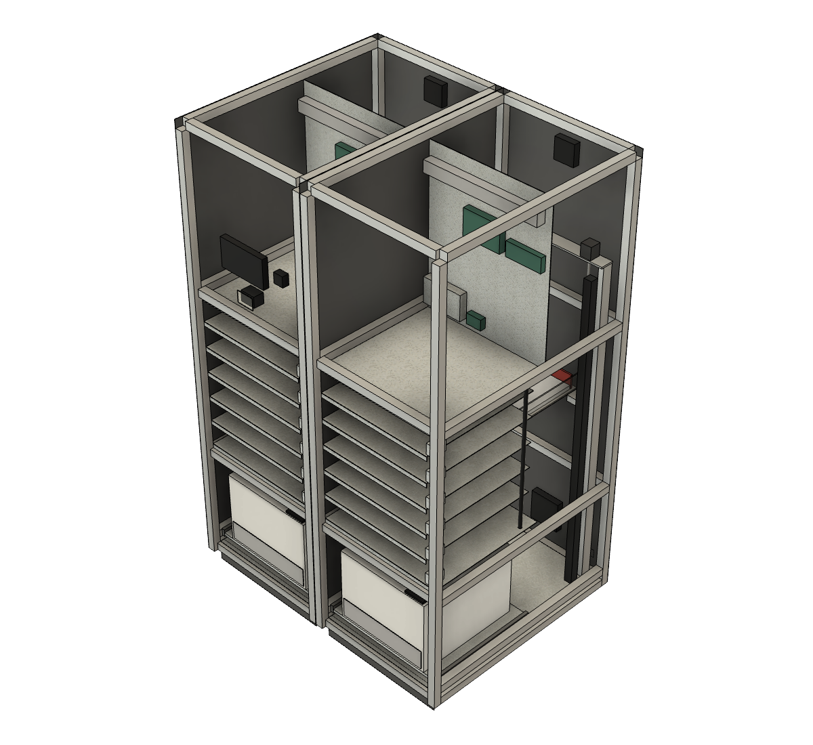
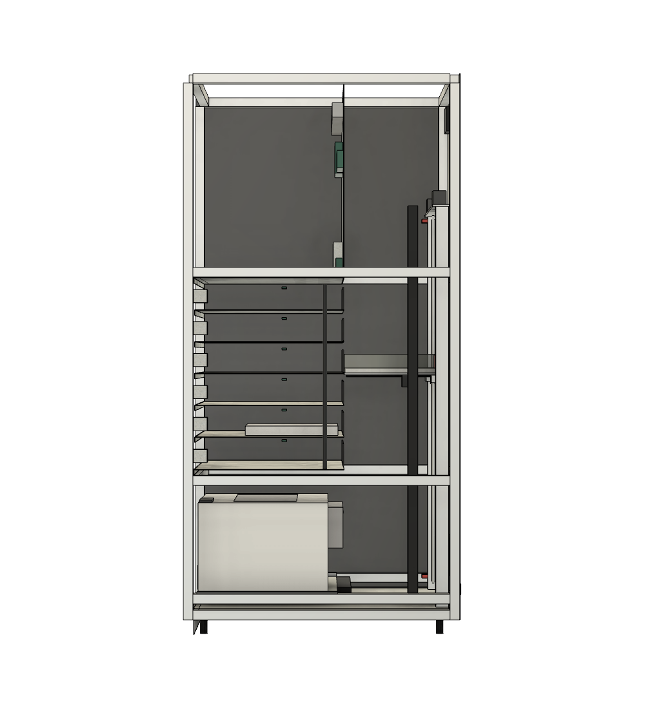
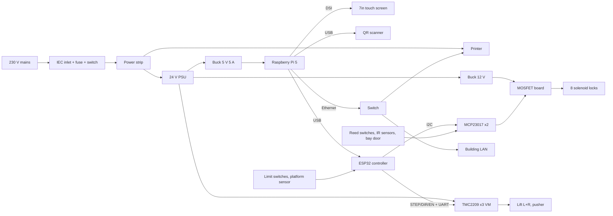

# PrintLocker kiosk — hardware design (M7)

The Fusion model is generated by [`fusion/build_kiosk.py`](fusion/build_kiosk.py). Open a new design in
Autodesk Fusion, go to Utilities › Scripts and Add-ins › +, pick the file and press Run. All sizes are in
the `P = dict(...)` block at the top: compartments, pitch, where the lift is shown, and `COLUMNS` if a
bigger kiosk with more printers is ever needed.

## Fabrication

DXF flat patterns, a PDF drawing set, the profile cut list and the bench-rig shopping list are in
[`fabrication/`](fabrication/README.md), generated from the model's parameters.

## Validation

The full delivery cycle has been simulated in Fusion with a collision check on every frame, and the motors,
timing and power have been checked by calculation: see [`simulation/`](simulation/README.md).

## Layout

**One kiosk = one printer + 8 compartments. Size 560 W × 860 D × 1750 H mm.**

| Height (mm) | Zone | Contents |
|---|---|---|
| 0–80 | Base | Levelling feet, base frame, kick plate |
| 80–498 | Printer bay | Kyocera PA4500x on a pull-out shelf (drawer slides); PT-320 face-up exit at the rear; key-locked front door |
| 498–1236 | Compartments | 8 × 90 mm pitch, 72 mm opening (a 500-sheet stack is ~50 mm); folded steel doors with solenoid lock, reed switch, IR paper sensor, one-way rear flap |
| 1236–1750 | Head | 7" screen (centre 1400 mm), QR scanner window (1290 mm), status LED strip; electronics plate behind the hinged head panel |
| Rear, y 500–858 | Lift shaft | Two 2040 extrusions with MGN12 rails, two T8 lead screws with their own NEMA17s, platform with side guides and a belt-driven pusher |

**Why 860 mm deep:** the printer is 416 mm deep. Behind it, the face-up exit needs about 320 mm of free
space so a sheet can leave the printer fully and land flat on the lift platform.

**Why the printer is at the bottom:** paper reams and toner are loaded at knee height from a pull-out shelf,
and jams are cleared there too. The compartments sit at 0.5–1.2 m and the screen at 1.4 m.

## How a print reaches a compartment

1. The lift waits at the bottom with its platform 20 mm below the PT-320 exit (platform top at 346 mm).
2. Sheets exit rearwards, face up, and stack against the pusher paddle.
3. When the job is done (CUPS reports it finished and no new sheet arrives for 5 s), the lift raises the platform level
   with the reserved compartment's floor.
4. The pusher drives the stack 320 mm forward, through the one-way rear flap, into the compartment.
5. The pusher returns, the lift goes back down, and the IR sensor confirms there is paper in the compartment.

Safety: the rear flap stops a hand reaching from an open compartment into the shaft. The lift does not move
while any door is open (reed switches). Locks are fail-secure (they stay locked without power). The back skin
is removable for servicing the shaft.

## Construction

- Frame: 30×30 aluminium extrusion: 4 posts plus rings at the base, bay top, head floor and top. Front rails
  sit 16 mm back so the doors close in front of them.
- Skins: 1.5 mm powder-coated steel (sides, top, removable back). Shelves and the electronics plate are 2 mm
  galvanised steel with a 16 mm folded front lip. Doors are folded steel, 15 mm deep.

## Bill of materials (one kiosk)

Prices are rough single-unit estimates in USD, not quotes.

| Item | Qty | Approx. USD |
|---|---|---|
| Kyocera ECOSYS PA4500x + PT-320 face-up rear tray | 1 | 650–750 |
| 30×30 aluminium extrusion, cut (≈ 19 m, see `fabrication/cut_list.csv`) + corner brackets, T-nuts | 1 set | 170 |
| 1.5 mm steel skins + 2 mm shelves + 9 folded doors, laser-cut and powder-coated | 1 set | 300–450 |
| Drawer slides 450 mm heavy duty (printer shelf) + 4 levelling feet | 1 pair + 4 | 40 |
| 2040 extrusion 1.26 m + MGN12 rail 1.2 m + block (lift guides) | 2 | 60 |
| T8 lead screw 1.25 m + brass nut + coupler + bearing | 2 | 40 |
| NEMA17 stepper (2 lift + 1 pusher) + TMC2209 driver | 3 + 3 | 55 |
| GT2 belt + pulleys (pusher), drag chain 15×30 1.2 m | 1 + 1 | 25 |
| Controller: ESP32 DevKit + 2× MCP23017 + 8-ch MOSFET board on a carrier PCB | 1 | 35 |
| 12 V solenoid cabinet lock | 8 | 80 |
| Reed switches + magnets, IR paper sensors (8 + 1 on the platform), limit switches | 8 + 9 + 3 | 30 |
| Mean Well LRS-150-24 (24 V 6.5 A) + buck 24→12 V 5 A + buck 24→5 V 5 A | 1 + 2 | 50 |
| Raspberry Pi 5 4 GB + SD + cooler + case | 1 | 100 |
| Raspberry Pi Touch Display 7" | 1 | 70 |
| USB 2D QR scanner module | 1 | 35 |
| Small gigabit switch, speaker + USB audio, WS2812 LEDs, fans 120/80 mm, IEC inlet with fuse and switch, power strip, wiring, DIN rail | 1 set | 130 |
| Polycarbonate (platform guides, rear flaps) | 1 set | 20 |
| **Total** | | **≈ 1,900–2,200 incl. printer (≈ 1,250–1,450 without)** |

## Wiring

### Controller pin map (ESP32 DevKit)

| ESP32 pin | Function | Notes |
|---|---|---|
| USB | Serial to the Pi | JSON lines, 115200 baud (protocol in `kiosk-agent/agent/hardware.py`, `column` is always 1) |
| GPIO 25 / 26 | Lift STEP / DIR | Both lift drivers share STEP and DIR, so the two lead screws stay in sync |
| GPIO 32 / 33 | Pusher STEP / DIR | |
| GPIO 13 | Driver ENABLE (all 3) | Active low; disabled when idle to cut heat |
| GPIO 16 / 17 | TMC2209 UART (addresses 0–2) | Current setting, StallGuard |
| GPIO 21 / 22 | I2C SDA / SCL | MCP23017 #1 at 0x20, #2 at 0x21 |
| GPIO 34 / 35 | Lift bottom / top limit | Input-only pins, external 10 k pull-ups |
| GPIO 39 | Pusher home switch | Input-only |
| GPIO 36 | Platform paper sensor | Counts sheets arriving; "no sheet for 5 s" = job finished |
| GPIO 4 | WS2812 data | Door LEDs + status strip |
| GPIO 18 | Fan PWM | |

| MCP23017 | Pins | Function |
|---|---|---|
| #1 0x20 | GPA0–7 | Lock 1–8 (to MOSFET gates, flyback diode on each lock) |
| #1 0x20 | GPB0–7 | Reed switch door 1–8 (closed = low) |
| #2 0x21 | GPA0–7 | Compartment 1–8 paper sensor |
| #2 0x21 | GPB0 | Printer bay door switch |

With one printer and one controller, the existing agent ↔ ESP32 protocol works unchanged.

## Open points to verify with the real printer

- Exact height and position of the PT-320 exit, and whether sheets stack flat on a bare platform
  (a slight backward tilt of 3–5° may help).
- Heat in the printer bay during a 200+ page job: the 120 mm rear fan is sized for it but not tested.
- Drawer slides rated for 15 kg printer + shelf, fully extended.
