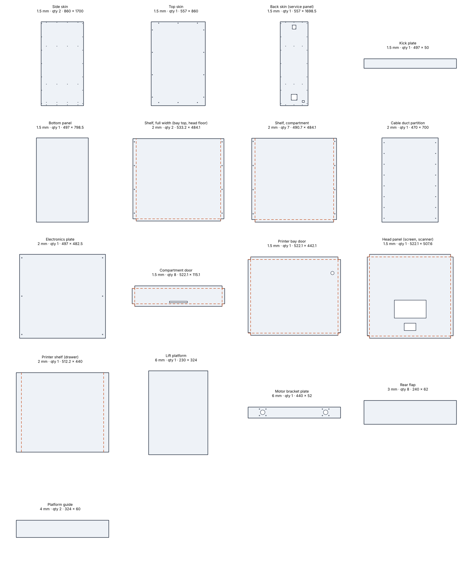

# Fabrication files

Generated by `make_fab.py` from the 3D model's parameters (`../fusion/build_kiosk.py`). If the model
changes, run `python3 make_fab.py` again; never edit the DXFs by hand.

| File | For | What it is |
|---|---|---|
| `dxf/*.dxf` | laser / punch shop | flat pattern per part. Layer `CUT` = outline and holes, `BEND` = bend lines, `TEXT` = label (don't cut). Units mm |
| `drawings.pdf` | workshop, assembly | cover sheet with all parts and the profile cut list, then one dimensioned page per part |
| `sheet_parts.csv` | quotes | part, material, thickness, quantity, flat size, hole/cut-out/bend counts |
| `cut_list.csv` | profile supplier | aluminium profiles, linear rails and lead screws, cut to length |
| `preview.png` | overview | all flat patterns on one image |

## One kiosk

- **Sheet and plate:** 17 different parts, 40 pieces. 1.5 mm DC01 steel for the skins and folded doors
  (powder-coated), 2 mm galvanised for the shelves, duct partition, electronics plate and printer shelf.
  6 mm aluminium for the lift platform and motor bracket, 3–4 mm polycarbonate for the flaps and guides.
- **Profiles:** 18.8 m of 30×30 slot-8 aluminium (4 posts of 1698.5 mm, 8 rails of 497 mm, 10 rails of
  798.5 mm), plus 2 × 20×40 lift guides of 1258 mm, 2 × MGN12 rails of 1220 mm and 2 × T8 lead screws of 1230 mm.

### Notes for the shop
- **Bends:** flat sizes use a bend deduction for 90° air bends with inner radius = thickness and
  K = 0.33 (1.5 mm → 2.87 mm, 2 mm → 3.82 mm). If your press brake differs, give us your deduction
  and the files will be regenerated with it.
- **Flange direction:** door and panel flanges fold back, away from the visible face. Shelf lips and side
  flanges fold down; the printer shelf flanges fold up.
- **Holes:** Ø5.5 for M5 into slot-8 T-nuts on the frame, Ø4.2 for 4 mm blind rivets, Ø3.4 for M3,
  Ø19 for the bay-door cam lock. Hinge and standoff holes are drilled on assembly.
- **Finish:** visible skins and doors powder-coated; galvanised parts left bare.
- **Tolerances:** ±0.2 mm on cut features, ±0.5 mm on bent flanges.

The frame in the cut list uses full-height posts with the rails between them, which is how it will
actually be bolted together. The concept model's rails are simplified, so for frame lengths the cut
list is the reference, not the 3D model.

## Bench rig for the one-compartment prototype (step 5)

Build this first, on plywood, before ordering the metal kiosk. The procedure is in
[`firmware/README.md`](../../firmware/README.md).

| Part | Qty | Example | Approx. USD |
|---|---|---|---|
| 20×40 extrusion, 900 mm (lift guides) | 2 | slot 6 | 20 |
| MGN12H linear rail 800 mm with block | 2 | | 30 |
| T8×8 lead screw 800 mm + brass nut + 5→8 mm coupler + KFL08 bearing | 2 sets | | 30 |
| NEMA17 stepper, 0.42 N·m (2 lift, 1 pusher) | 3 | 17HS4401 | 30 |
| TMC2209 driver with UART | 3 | BTT TMC2209 v1.3 | 20 |
| GT2 belt 1 m, 20T pulley, idler | 1 set | | 8 |
| ESP32 DevKit (WROOM-32) | 1 | | 8 |
| MCP23017 breakout | 2 | | 6 |
| 8-channel MOSFET board (or 1 logic-level MOSFET + 1N4007 for one lock) | 1 | | 8 |
| 12 V solenoid cabinet lock | 1 | LY-03 | 8 |
| Reed switch + magnet | 1 | | 2 |
| IR reflective sensor (platform counter + compartment) | 2 | TCRT5000 module | 3 |
| Microswitch limit switches | 3 | | 3 |
| 24 V 150 W PSU + 24→12 V 5 A buck | 1 + 1 | Mean Well LRS-150-24 | 35 |
| WS2812 LED strip 0.5 m | 1 | | 5 |
| 18 mm plywood sheet, 3 mm polycarbonate, 6 mm aluminium offcut (platform) | 1 each | | 60 |
| Wire, Dupont/JST connectors, terminal blocks, screws, T-nuts | 1 set | | 30 |
| **Total** | | | **≈ 310** |

Optional for the last stage: the Raspberry Pi 5 and the Kyocera printer from the kiosk BOM.
