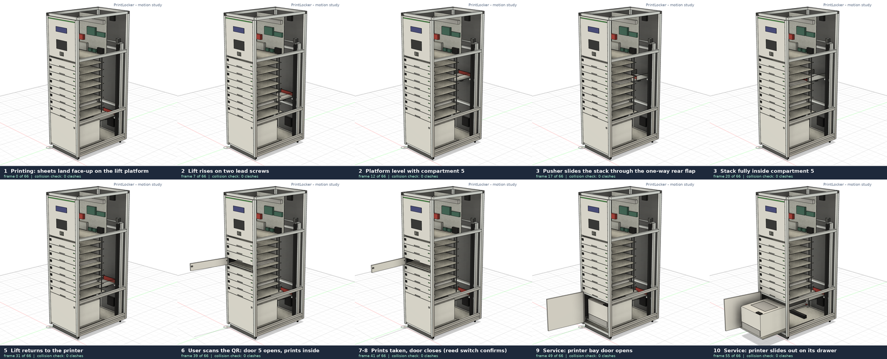

# Motion study and engineering checks (step 1 and 2 of design validation)

`cycle.gif` / `cycle.mp4` play the same keyframes as an animation.

## 1. Motion simulation in Fusion

**Result: the full cycle runs with 0 collisions in all 66 frames** (after one fix, below).

The model (`../fusion/build_kiosk.py`) builds every moving part as its own component. These are the lift
carriage, pusher paddle, paper stack, 8 doors, 8 rear flaps, the printer bay door and the printer drawer.
`../fusion/simulate_cycle.py` then drives them through one full cycle. For each of the 66 frames it poses
the parts and runs Fusion's interference analysis over all 181 bodies, then saves the result.

| Step | Motion | Frames | Clashes |
|---|---|---|---|
| 1 | Printing: sheets land face-up on the platform (bottom, 346 mm) | 0–2 | 0 |
| 2 | Lift rises 540 mm to compartment 5 | 3–12 | 0 |
| 3 | Pusher drives the stack 320 mm through the one-way rear flap | 13–20 | 0 |
| 4 | Pusher returns, flap falls shut behind it | 21–26 | 0 |
| 5 | Lift returns to the printer | 27–34 | 0 |
| 6–8 | Door 5 unlocks, swings open 100°, prints taken, door closes | 35–45 | 0 |
| 9–12 | Service: bay door opens 100°, printer drawer slides out 380 mm and back | 46–65 | 0 |

**Found and fixed:** in the first run, the printer shelf rubbed the opened bay door near its hinge by about
1.5 mm (frames 51–59). The door's 15 mm thickness swings into the drawer's path. The shelf is now 6 mm
narrower on each side (52–508 mm), which leaves 4.5 mm of clearance. The printer still fits.

Intended contacts are excluded from the check: the lead screws run through the screw nuts and lift arms,
and each nut sits inside its arm.

To re-run it, build the model, then run `simulate_cycle.py` in chunks (`START`/`END`). Frames and
`frames.jsonl` (pose + clashes per frame) are written to `~/PrintLocker/simulation/frames`.
`show_frame.py` poses the model at any single frame.

## 2. Motors, timing and power

`calc_mechanics.py` prints this table; every assumption is at the top of the file.

| Check | Value | Limit | Result | Note |
|---|---|---|---|---|
| 500-sheet stack height | 50 mm | opening 72 mm | PASS | 22 mm headroom |
| Pusher paddle vs ceiling | 55 mm paddle | opening 72 mm | PASS | 15 mm clearance |
| Pusher force needed (500 sheets, μ 0.5) | 12.2 N | motor gives 33 N | PASS | safety factor 2.7 |
| Lift torque per screw (5.0 kg moving) | 0.104 N·m | motor 0.21 N·m | PASS | safety factor 2.0 |
| Lift holds position without power | lead angle 17.7° | friction angle 8.5° | CHECK | T8×8 screws back-drive (see below) |
| Lift speed | 80 mm/s | | PASS | 600 rpm × 8 mm lead |
| Delivery after last sheet (compartment 1 / 8) | 17 s / 33 s | < 60 s | PASS | average 25 s |
| 200-page duplex job, print time | 267 s | | PASS | delivery adds about 9% |
| 24 V peak load (incl. converter losses) | 80 W | PSU 150 W | PASS | 53% of the PSU |

**One design decision came out of this:** the fast 8 mm-lead screws are not self-locking. Without power the
loaded platform slides down. The plan is to keep the stepper drivers enabled at hold current while
the lift is away from home, and add a rubber end stop at the bottom. The lift already waits at the bottom
between jobs, so a power cut can only drop it mid-delivery, with the paper still on the platform. The
alternative is 2 mm-lead screws, which are self-locking but make deliveries about 4× slower.

## What this does not prove yet

- How real sheets behave leaving the PT-320: whether they stack flat, curl or stick by static.
  This needs the bench test with the real printer (step 4).
- Whether the top sheets of a tall stack slide ahead of the paddle (shingling) when pushed.
- The friction and stiffness numbers above are catalogue estimates, to be measured on the prototype.

## Next steps

3. Software twin: give the kiosk simulator these real timings and the exact motor/sensor sequence.
4. Paper bench test with the real printer and a plywood platform mock-up.
5. One-compartment prototype (lift, pusher, one door).
6. Full metal kiosk.
